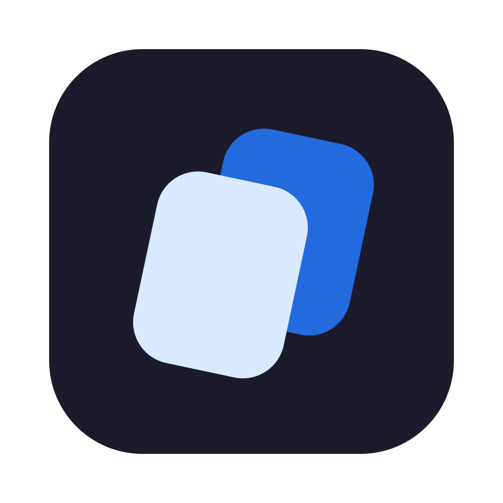
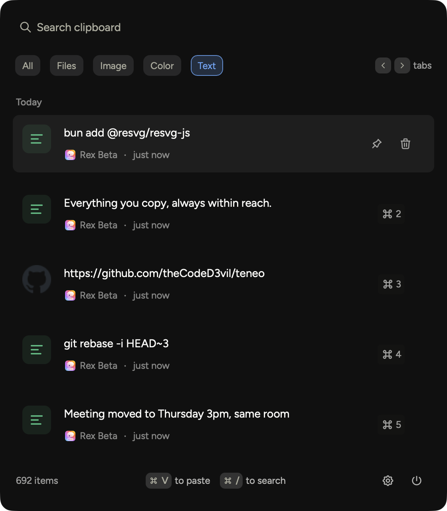
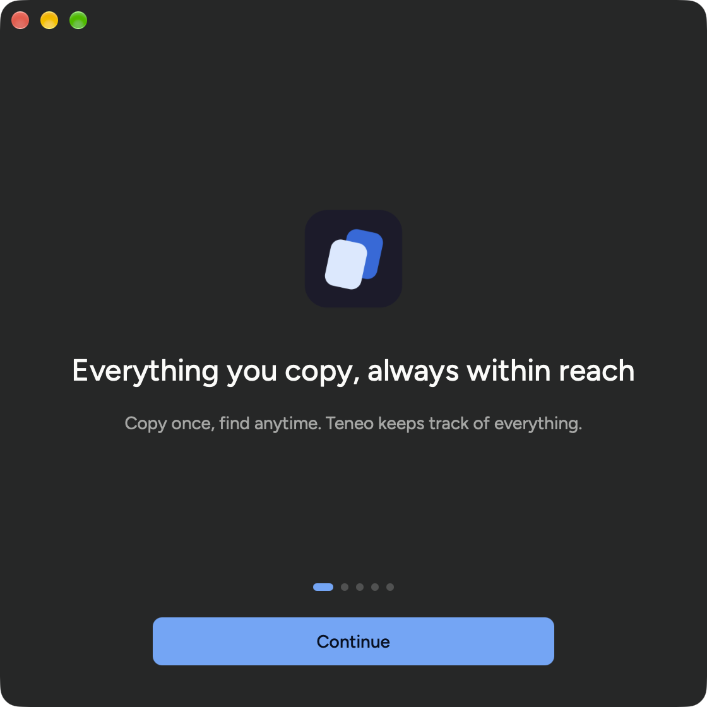
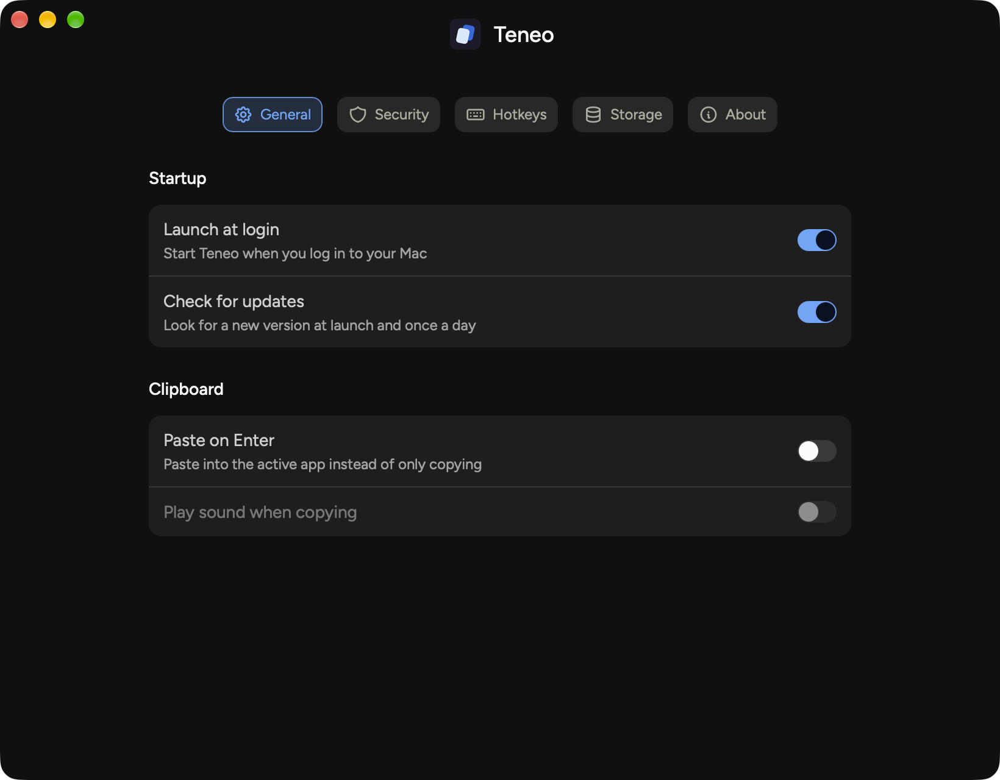
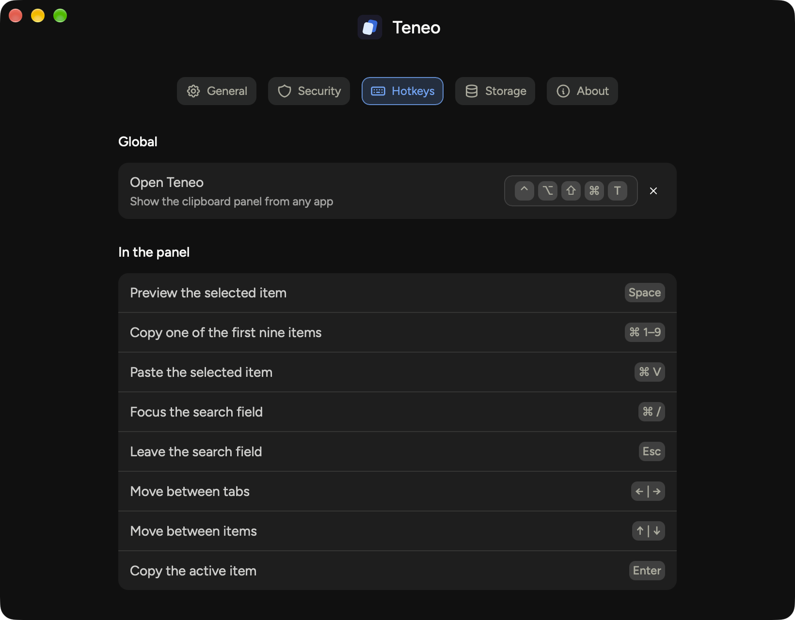

<p align="center">
  
</p>

<h1 align="center">Teneo</h1>

<p align="center">Everything you copy, one click away in your menu bar.</p>

<p align="center">
  <a href="https://github.com/theCodeD3vil/teneo/releases/latest"><strong>Download for macOS</strong></a>
</p>

Teneo is a clipboard manager for your Mac. It sits quietly in the menu bar and remembers everything you copy. Your history is stored locally on your Mac. Nothing ever leaves.

## Installation

Teneo runs on macOS, on both Apple Silicon and Intel Macs.

1. Open the [latest release](https://github.com/theCodeD3vil/teneo/releases/latest) and download the disk image for your Mac:
   - **Apple Silicon** (M1 or later): `teneo-<version>-macos-arm64.dmg`
   - **Intel**: `teneo-<version>-macos-x86_64.dmg`

> Not sure which you have? Open the Apple menu › **About This Mac**. A **Chip** line means Apple Silicon; a **Processor** line means Intel.

2. Open the disk image and drag **Teneo** into **Applications**.
3. Open Teneo from Applications. macOS blocks it the first time, because Teneo isn't notarized by Apple yet. Click **Done**, then go to **System Settings › Privacy & Security**, scroll down to the bottom, and click **Open Anyway** next to the message about Teneo. You only need to do this once.
4. A welcome window walks you through setup. Complete it and Teneo is ready to be used.

### Accessibility permission

Teneo needs Accessibility permission to paste into the app you're using. Without it, Teneo still saves your history and copies items; you just paste them yourself with ⌘V.

You can allow it in either of two ways:

- **In Teneo's setup window.** Click **Grant access**: System Settings opens on the right page. Turn on **Teneo**, then come back, and the setup window moves on by itself. If you chose **Set up later**, open Teneo's Settings (the gear in Teneo's panel) and click **Finish setup** in the banner at the top to bring the setup window back.
- **Manually in System Settings.** Open **System Settings › Privacy & Security › Accessibility** and turn on **Teneo**. If Teneo isn't in the list, click **+** below it and choose Teneo from Applications.

Teneo's **Settings › Security** tab shows whether access is allowed.

### Desktop, Documents and Downloads

When you copy a file from your Desktop, Documents or Downloads folder (or iCloud Drive, or another drive), Teneo shows its preview and size. macOS asks whether Teneo can see each of those folders. Setup asks for all three at once; you can skip it, and macOS asks the first time it's needed.

If you don't allow a folder, files you copy from it still paste, just without a preview. To change your answer, open **System Settings › Privacy & Security › Files and Folders** and find **Teneo**.

### Keychain (only if you encrypt API keys)

**Encrypt API keys** is off unless you turn it on, in setup or in **Settings › Security**. When it's on, Teneo keeps the key that unlocks your saved API keys in your macOS Keychain, and macOS may ask for your Mac password to let Teneo use it. Click **Always Allow** so it doesn't ask every time.

> [!NOTE]
> **macOS asks again after each Teneo update.** Teneo isn't signed with an Apple Developer ID yet, so macOS treats every new version as a new app and asks for your Mac password once more. Enter it and click **Always Allow**. This goes away once Teneo is signed with a Developer ID. If you'd rather not see it, turn off **Encrypt API keys**: your keys stay hidden in history either way.

Teneo keeps itself up to date: when it starts and once a day after that, it looks for a new version and asks before installing it. You can turn this off with **Settings › General › Check for updates**, and check any time from **Settings › About › Check now**.

## Features

- **Remembers everything you copy.** Text, images, files and colors are saved as you copy them, each with the app it came from and when.
- **Finds it fast.** Search your whole history, or narrow it down with the **Files**, **Image**, **Color** and **Text** tabs.
- **Works from the keyboard.** Set your own shortcut to open Teneo from any app, then:

  | Action                                   | Keys       |
  | ---------------------------------------- | ---------- |
  | Move between items                       | `↑` \| `↓` |
  | Move between tabs                        | `←` \| `→` |
  | Copy the selected item                   | `Enter`    |
  | Copy one of the first nine               | `⌘ 1–9`    |
  | Paste the selected item into focused app | `⌘ V`      |
  | Pin or unpin the selected item           | `P`        |
  | Delete the selected item                 | `D`        |
  | Jump to the search field                 | `⌘ /`      |
  | Leave the search field                   | `Esc`      |
  | Preview the selected item                | `Space`    |

  Clicking an item copies it, and double-clicking opens its preview. While a preview is open:

  | Action                        | Keys                    |
  | ----------------------------- | ----------------------- |
  | Go back to the list           | `Esc` \| `Space` \| `←` |
  | Copy the item and close Teneo | `Enter`                 |

- **Pastes for you.** Paste straight into the app you were using, or turn on **Paste on Enter** to paste every time you pick an item. This also happens automatically with the `⌘ + 1-9` hotkeys and `⌘ + V` keys
- **Shows where links go.** A link you copy shows its site's icon and name, so you can tell links apart at a glance. Teneo gets the icon from the site itself, never from a third-party service, and never opens sign-in, password-reset or local network links. Turn it off in **Settings › Security**.
- **Previews any item (beta).** Press `Space` or double-click an item to see it in full. Each preview has **Pin** and **Delete** at the top.
  - **Text** shows in full. Code is highlighted when Teneo recognizes the language, and buttons turn the text into UPPERCASE, lowercase, Capitalized, camelCase, snake_case or kebab-case before you copy it. Text with an API key stays hidden until you click **Reveal**, and has no case buttons.
  - **Links** show the page's own image, or the site's home page image, or its icon, with the full link and an **Open in browser** button.
  - **Images and files** show a large preview, with their name, size or dimensions, and buttons to **Open**, **Show in Finder** and **Copy**. Several files show as a grid.
  - **Colors** show as hex with their CSS name when they have one, in OKLCH, HSL and RGBA with a copy button each, and in five lighter and five darker shades. Click a shade to copy it in any format.
- **Leaves passwords alone.** Anything copied from a password manager is skipped, and you can add any other app you want Teneo to ignore.
- **Hides API keys (beta).** Keys from GitHub, OpenAI, Anthropic, Stripe, AWS and other services, private keys, and passwords in URLs show as asterisks (`***`) in history, but paste in full. Teneo finds them on your Mac and never sends them anywhere. Turn it off in **Settings › Security**, where you can also have them saved encrypted (see [Keychain](#keychain-only-if-you-encrypt-api-keys)).
- **Keeps only what you want.** Choose how long to keep history (1 day to forever), how many items to keep, and how much space it may use. Pinned items always stay, and don't count toward these limits.

### Good to know about previews

- **Previews come from macOS.** Images, PDFs, video and code show their content, as Finder's Quick Look does. Any file type macOS can't draw shows its icon instead.
- **Protected folders need permission.** A file copied from your Desktop, Documents, Downloads, iCloud Drive or another drive shows only an icon until you let Teneo see that folder (see [Desktop, Documents and Downloads](#desktop-documents-and-downloads)). Open, Show in Finder and Copy still work.
- **Link images are fetched from the site itself.** Teneo opens the copied page only when it's safe to: never for sign-in, password-reset, unsubscribe or one-time links, nor for addresses on your Mac or local network. **Settings › Security › Show link previews** turns all of this off.
- **Show in Finder selects the first file** when you copied several. **Open** opens them all.
- **A click copies after a short pause,** so a double-click can open the preview without copying the item first. Keyboard shortcuts copy right away.

## Screenshots

<p align="center">
  
  <br>
  <em>Your clipboard history, searchable and sorted by type</em>
</p>

<p align="center">
  
  <br>
  <em>A short setup the first time you open Teneo</em>
</p>

<p align="center">
  
  <br>
  <em>General settings</em>
</p>

<p align="center">
  
  <br>
  <em>Every shortcut, in one place</em>
</p>

## Roadmap

Here's what's planned next. More will be added over time.

- **Previews (in progress, beta).** Open any item in your history to see it in full, and do more with it than copy and paste. A first version is out to try; see [Features](#features).
- **Landing page (done).** A proper home for Teneo, where you can explore what it does and download it.
- **Sync engine.** Keep your clipboard history in your own cloud storage instead of only on your Mac (bring your own cloud).
- **Android app (in progress).** Sync your clipboard history between your Android phone and your Mac. It keeps its own history on the phone; syncing it comes next.

## Development

Teneo is a [Bun](https://bun.sh) workspaces monorepo, with [Turborepo](https://turborepo.dev) running its builds and checks.

| Folder            | What it holds                                                                                                                                       |
| ----------------- | --------------------------------------------------------------------------------------------------------------------------------------------------- |
| `apps/desktop`    | The Mac app: Vue frontend in `src/`, TinyJS backend in `backend/`.                                                                                  |
| `apps/site`       | The landing page.                                                                                                                                   |
| `apps/mobile`     | The Android app (see [Android app](#android-app)).                                                                                                  |
| `packages/ui`     | `@teneo/ui`: the UI components, theme and helpers that the Mac app, the site and the Android app share.                                             |
| `packages/shared` | `@teneo/shared`: the types, constants and pure rules (such as secret detection) the apps share. It ships TypeScript source, with no build step.     |
| `packages/sync`   | `@teneo/sync`: the clipboard sync core (merge rules, protocol, engine), with no runtime of its own. Not turned on yet; its README has the protocol. |

Run these from the repo root:

| Command                                              | What it does                                      |
| ---------------------------------------------------- | ------------------------------------------------- |
| `bun install`                                        | Installs every workspace.                         |
| `bun run desktop`                                    | Runs the app as Teneo Debug, on its own data.     |
| `bun run desktop:reset-dev-data`                     | Wipes that dev data (see below).                  |
| `bun run site`                                       | Serves the landing page.                          |
| `bun run mobile`                                     | Serves the Android app in a browser.              |
| `bun run build` \| `typecheck` \| `test`             | Runs that task in every workspace (Turbo caches). |
| `bun run lint` \| `lint:fix` \| `fmt` \| `fmt:check` | Lints and formats the whole repo, once.           |

**The checks run on every pull request.** `bun run typecheck`, `test`, `lint` and `fmt:check` run on GitHub for each PR into `development` or `main`, and for each push to `development` (`.github/workflows/checks.yml`), so run them before you push. They need only a Linux runner, so `test:runtime` (below) isn't among them: run that yourself when you change sync storage or transport.

**Three apps, by name.** A full release is **Teneo** (`com.michael.teneo`), a beta is **Teneo Beta** (`com.michael.teneo.beta`) and a dev run is **Teneo Debug** (`com.michael.teneo.debug`), so they install and run side by side, each with its own history, settings, Keychain entries and macOS permissions (`apps/desktop/backend/app-identity.ts`). tinyjs takes the name and id from `tinyjs.json` only, which is committed as Teneo's: `bun run desktop` makes it Teneo Debug's while it runs and puts it back when it ends, and the release workflow makes it Teneo Beta's for a beta version. So don't commit `tinyjs.json` with a dev run open. Two of them running share the same shortcut until you change it in one.

**A dev run never touches your real history.** `bun run desktop` keeps its own database, images, link previews, settings and Keychain key under Teneo Debug's id: files go in a `dev` folder inside its data and cache folders, and the settings, setup flag and Keychain entry get a `-dev` name. A packaged build is not affected. The dev data starts empty, so the setup window shows on the first dev run.

- `bun run desktop:reset-dev-data` deletes the dev folders and the dev keys and Keychain entry, and the ones older dev runs left inside the installed Teneo's folders. It leaves the installed app's data alone.
- `TENEO_REAL_DATA=1 bun run desktop` runs on the installed Teneo's data instead, under Teneo's id, to check a change against a real history. Quit the installed Teneo first: one instance runs per app id. Teneo logs a warning at startup when it does. Back up `~/Library/Application Support/com.michael.teneo` first.
- `bun run test:runtime`, from `apps/desktop`, runs the sync tests that need the real TinyJS runtime (`tjs:sqlite` and its network server; `bun test` has neither): the storage tests, the transport tests and the tests of the pid files that clean up after a killed Teneo. It bundles each test with esbuild and runs it with `~/.tinyjs/bin/tjs` on a temp folder, never on your history. Turbo's `test` leaves it out, since it needs that runtime installed.
- `bun run sync:peer <recovery code>` starts a second Teneo device with no window, on the real runtime and in a temp folder of its own, to try syncing against the app or another peer. `--name <name>` names it; `--dir <folder>` keeps its history between runs. It prints what it receives (this is a test tool: item text is shown) and reads commands on stdin: `copy <text>`, `from <bundle id> <name>` (the app the next copies are from), `image <png file>` (a copied image), `color <css colour>` (a copied colour), `pin <id>`, `unpin <id>`, `delete <id>`, `clear`, `list`, `peers`, `quit`. `bun backend/sync/new-recovery-code.ts`, from `apps/desktop`, prints the recovery code of a new, empty vault to start two peers with. `bun run sync:peer --app` instead runs the peer the way the app runs sync, through the same `SyncManager` and signal handling, with sync off to begin with and a throwaway vault of its own; it also takes `turnon`, `join <recovery code>`, `code`, `secrets on|off`, `off` and `status`, which are what the Sync tab does.
- `bun run sync:check` starts two such peers and checks that they find each other over Bonjour and end up with the same history: a copy, a pin, a delete and a clear, one peer restarted while the other changed things, a client that doesn't speak Teneo refused, no Bonjour process left running afterwards, and a peer that is killed outright (its Bonjour processes outlive it, so a Teneo notes their pids in `bonjour-<pid>.pids` in its cache folder, and the next one ends those, and only those). It ends with a peer run the app's way (`--app`) against a plain one: sync turned on, joined by recovery code, the existing history arriving, changes both ways, the secrets switch, a quit by SIGTERM and a launch that turns sync on by itself, and turning sync off. The first connection can take up to a minute. It needs ports 47823 to 47827 free, so stop any other syncing Teneo or peer first. macOS may ask to let `tjs` find devices on the local network the first time.
- Sync is on in beta builds: while the version in `apps/desktop/tinyjs.json` has a `-beta` suffix, the Sync tab shows in Settings, in `bun run desktop` and in the released app. With a full version it needs `TENEO_SYNC=1 bun run desktop`; without that, sync is hidden and does nothing: no listener, no Bonjour, nothing sent. In the tab, _Turn on_ makes a vault key (kept in the Keychain), _Add a device_ shows the recovery code and a QR code, and _Join_ takes a recovery code from another device. To try it without a second Mac, turn sync on, show the code, and start `bun run sync:peer <recovery code>`.

TinyJS reads everything from the current folder, so run any `tinyjs` command (`build`, `publish`) from `apps/desktop`. A plain `tinyjs dev` or `tinyjs build` there runs or builds whatever `tinyjs.json` says, which is Teneo. The release version lives in `apps/desktop/tinyjs.json`.

`tinyjs dev` restarts the backend when a file in `apps/desktop/backend` changes, but not when one in `packages/shared` does (TinyJS only watches a `shared/` folder beside `backend/`). After editing `packages/shared`, restart `bun run desktop` to pick the change up in the backend. The frontend still reloads on its own.

### Android app

`apps/mobile` is the Android app: Vue and Tailwind on the shared `@teneo/ui` components, wrapped with [Capacitor](https://capacitorjs.com). The native project in `apps/mobile/android` is committed.

Screens only talk to the `TeneoClient` interface (`apps/mobile/src/client`). On a phone that is `NativeClient`: the history lives in a SQLite database the Android app owns (`android/app/src/main/java/com/michael/teneo/history`), so it outlives the app and a later background service can reach it. In a browser it is `FakeClient`, which keeps a seeded history in memory. Both still pretend to sync and pair.

The phone saves what was copied on it in two ways (`android/app/src/main/java/com/michael/teneo/capture`): the clipboard when Teneo comes to the front, if "Save what's on the clipboard when Teneo opens" is on, and a text shared to "Save to Teneo". Native code saves the text as it is; `NativeClient` looks for secrets and links in it with the Mac's rules (`packages/shared/src/detection`) before the history is listed.

Both clients pass the same tests (`client-contract.ts`): `bun run test` runs them against `FakeClient`, and `bun run --cwd apps/mobile android:contract` runs them on a phone against the native history, in a throwaway database. That needs the debug build from `bun run mobile:android:dev`, with `bun run mobile` serving. The native code's own unit tests run with `mise exec -- ./android/gradlew -p android :app:testDebugUnitTest` in `apps/mobile`.

To build it for a phone you need:

- **Java 21.** `apps/mobile/mise.toml` pins it, and the Android scripts run Gradle through [mise](https://mise.jdx.dev), so run `mise install` in `apps/mobile` once. Newer Java versions break the Android build tools.
- **The Android SDK**, with platform 36.1 and its build tools. Android Studio installs it. Gradle finds it through `ANDROID_HOME`, or `sdk.dir` in `apps/mobile/android/local.properties` (not committed).
- **An Android phone** running Android 10 or later, with USB debugging on, that `adb devices` lists. Scanning the Mac's QR code uses Google's code scanner, so the phone needs Google Play services. Teneo never asks for the camera permission.

Then, from the repo root:

| Command                      | What it does                                                                                                                                      |
| ---------------------------- | ------------------------------------------------------------------------------------------------------------------------------------------------- |
| `bun run mobile`             | Serves the app at `http://127.0.0.1:5175`. Open it in a phone-sized browser window. The browser can't scan, so it offers the typed recovery code. |
| `bun run mobile:android`     | Builds the app, installs it on the phone and opens it.                                                                                            |
| `bun run mobile:android:dev` | Installs a build that loads the app from `bun run mobile` over USB, so edits show on the phone as you save. Keep `bun run mobile` running.        |

`mobile:android:dev` points the phone at your Mac through `adb reverse`, so it only works while the phone is plugged in. Run `bun run mobile:android` to go back to a build that works on its own. The debug APK lands in `apps/mobile/android/app/build/outputs/apk/debug`.

The Android scripts aren't part of Turbo's `build`, so CI and the Mac release workflow don't need Java or the Android SDK.

#### The sync service

Sync on the phone runs in a foreground service (`apps/mobile/android/app/src/main/java/com/michael/teneo/sync`), so it keeps going with the screen off. The service owns a web view with no window that runs the sync core, the same `@teneo/sync` the Mac runs (`apps/mobile/src/sync-service`, built as a second page, `sync.html`, beside the app). The core decides everything; Java does what a page can't: it listens for devices on ports 47823 to 47827, dials the ones Bonjour finds, and announces and browses `_teneo-sync._tcp`. A permanent, low-priority notification shows while it runs. The rules for who may connect, and for retrying, are the Mac's: see `apps/desktop/backend/sync/lan-transport.ts`.

Nothing in the app starts it yet, and a release build has no service to start: the service, its permissions and its starter are in `apps/mobile/android/app/src/debug`. A debug build starts it from `adb shell` only, with the recovery code of a vault (a throwaway one, from `bun backend/sync/new-recovery-code.ts` in `apps/desktop`, then `bun run sync:peer "<code>"` for a Mac to sync with). The code is kept in memory, so a restart of the whole app forgets it and sync stops until it is given again.

Sync works on the phone's own history, the database the app lists from. The page can't open SQLite, so it asks native code through `TeneoNative`: `history*` calls that answer in JSON (`SyncStoreBridge.java`, answered by `HistoryStore.java`), which `apps/mobile/src/sync-service/native-store.ts` turns into the `SyncStore` the engine needs. The rules are the Mac's (`apps/desktop/backend/sync/sync-store.ts` and `records.ts`, whose row-to-record mapping is copied into `records.ts` beside it, so keep the two the same). A few things differ because the page and the database are apart:

- **A transaction is saved at once.** What the engine writes is kept in the page, and read back by the reads that follow it, until the transaction ends; then one call saves it all in one database transaction, with the cursor. If the app wrote to the history meanwhile (a pin, a copy), nothing is saved, and the engine's work runs again on what is there now.
- **One source of pin stamps.** The device id is the one in `SYNC_META`, and the clock that stamps a pin is `HistoryStore`'s (`Hlc.java`); the page has none. Every stamp the page saves from another device is seen by that clock as it is saved, so a pin made on the phone afterwards wins, whatever the phone's clock says.
- **Secrets are looked for before a text is sent.** The capture and the share sheet save a text without looking (the app does that before it lists), so the page looks at each text it is about to send, in TypeScript with `@teneo/shared/detection`, and stores what it finds. A text it can't look at is held back. A text that arrives is looked at the same way before it is stored, with the detection version.
- **Images are files native code keeps.** A row says an image's size and the hash of its file (`HistoryStore.java`, `ImageFiles.java`: one file per image in the app's `images` folder); the page asks for and hands over the bytes a piece at a time. An image that arrives is listed once its file is whole and has the hash its record named. The phone saves an image shared to it or found on the clipboard when it opens, and puts one back on the clipboard through its file provider. Files are never synced, in either direction.
- **A colour is found, not copied as one.** The Mac turns a copied text that is exactly one CSS colour into a colour item as it reads its clipboard. The phone's texts come from sync and the share sheet too, so it looks for a colour the way it looks for secrets and links (`apps/mobile/src/client/detection.ts`, by the Mac's own rule in `@teneo/shared/detection/colors`) and keeps it in the row's `color`: the row stays a text, which is what a copy gives and what syncs, and the app shows it as a colour and lists it under Color. A Mac's colour item syncs as that text too, and a text that arrives and is a colour becomes a colour item on a Mac.
- **Icons come from the Mac.** An item says only its app's name, so the phone asks a Mac for the icon of each app it hasn't seen (`AppIcons.java` keeps one png per name, in the app's files), and the app's page shows it by the name. The phone in turn says who made it (`Build.MANUFACTURER`), and the Mac shows that maker's logo by the items copied on it: Google's and Apple's so far (`packages/ui/src/utils/device-makers.ts`); the phone shows the same logo by its own copies and another phone's.
- **Both ways are live.** A change to the history made by anything in the app reaches the page (`teneoSyncPage.localChanged`), which sends it on; a change that arrives is saved through `HistoryStore`, so the app's list hears of it through the history's change event, as for a copy made on the phone.

The in-memory store of `@teneo/sync/testing` is for tests only. `bun run test` runs the store against a fake of the native side (`fake-history.ts`), and the real engine against it; the SQL has Java tests (`SyncQueriesTest`), which only check its text, as there is no SQLite on the JVM. In a debug build `--es copy` saves a copy as the capture does, so it travels like any other.

```sh
adb shell "am start-foreground-service -n com.michael.teneo.debug/com.michael.teneo.sync.DebugSyncService --es code '<recovery code>'"
adb shell "am start-foreground-service -n com.michael.teneo.debug/com.michael.teneo.sync.DebugSyncService --es copy 'text to copy on the phone'"
adb shell "am start-foreground-service -n com.michael.teneo.debug/com.michael.teneo.sync.DebugSyncService --ez dial false"  # only listen, never dial
adb shell "am start-foreground-service -n com.michael.teneo.debug/com.michael.teneo.sync.DebugSyncService --ez stop true"
adb logcat -s TeneoSync                                                                                             # what it does
```

Before the Sync screen starts this service for real, one thing has to be settled: the sync page and the app's own page share one web view process. If that process dies while the app's window is alive, Capacitor lets Android end the whole app, and the service comes back with no recovery code to start with. Either the service runs in a process of its own, or the app handles the loss of its page.

The Java tests (WebSocket framing, handshake, limits, and the listener and dialer on loopback) run with `cd apps/mobile && mise exec -- ./android/gradlew -p android testDebugUnitTest`. They need the same Java and SDK as a build, so CI doesn't run them. The TypeScript side is in `bun run test` as usual.

#### Releasing the Android app

The Android app releases the way the Mac app does, from its own version: `"version"` in `apps/mobile/package.json`. When a PR is merged into `main` and that version has no `android-v<version>` tag yet, `.github/workflows/release-android.yml` builds a signed APK and publishes it as the GitHub release "Teneo for Android `<version>`", with the PR's title and description as the notes. So bump the version in the PR to ship a release. A PR can bump the Mac version, the Android version or both.

- **The version** is three numbers such as `1.2.3`, the last two under 100, or a beta of one such as `1.2.3-beta.4` (beta numbers 1 to 98). Gradle reads it from `package.json` and makes Android's version code from it (`1.2.3-beta.4` is `1020304`, and `1.2.3` is `1020399`). Android only updates to a larger one, so the version only goes up, and a beta comes before its full release.
- **Three apps, by name.** A full release is **Teneo** (`com.michael.teneo`), a beta is **Teneo Beta** (`com.michael.teneo.beta`) and a debug build, which is what `bun run mobile:android` installs, is **Teneo Debug** (`com.michael.teneo.debug`). Each has its own history, settings and pairing, so all three install side by side. Gradle picks the name and id from the version and the build type (`apps/mobile/android/app/build.gradle`). Android won't update one app with another, so Teneo Beta is offered only newer betas and Teneo only full releases.
- **A beta is a pre-release.** A version with a suffix is published as a GitHub pre-release, for the Mac app too (`0.4.0-beta.1` in `apps/desktop/tinyjs.json`). A pre-release is never "latest", so Macs running a full release are not updated to it. Teneo Beta on a Mac updates from the `beta-channel` release instead, which holds only the newest beta's `manifest.json`: the Mac release workflow replaces it on every beta. Neither app updates into the other.
- **The signing key** is one PKCS12 keystore holding a key named `teneo`. The workflow reads it from two repo secrets, `ANDROID_KEYSTORE_P12` (the keystore file, base64) and `ANDROID_KEYSTORE_PASSWORD`, which come from Doppler's `prd` config like the Mac certificate. Android only installs an update signed with the key of the app it replaces, so keep a copy of the keystore and its password somewhere safe: without them, nobody who has the app can update it.
- **The release is never marked "latest".** The Mac app updates from `releases/latest`, which has to stay a Mac release.
- `bun run mobile:android:release` makes the same build on your Mac, in `apps/mobile/android/app/build/outputs/apk/release`. It is signed if `TENEO_ANDROID_KEYSTORE` (the keystore's path) and `TENEO_ANDROID_KEYSTORE_PASSWORD` are set, and unsigned, which a phone won't install, if not.
