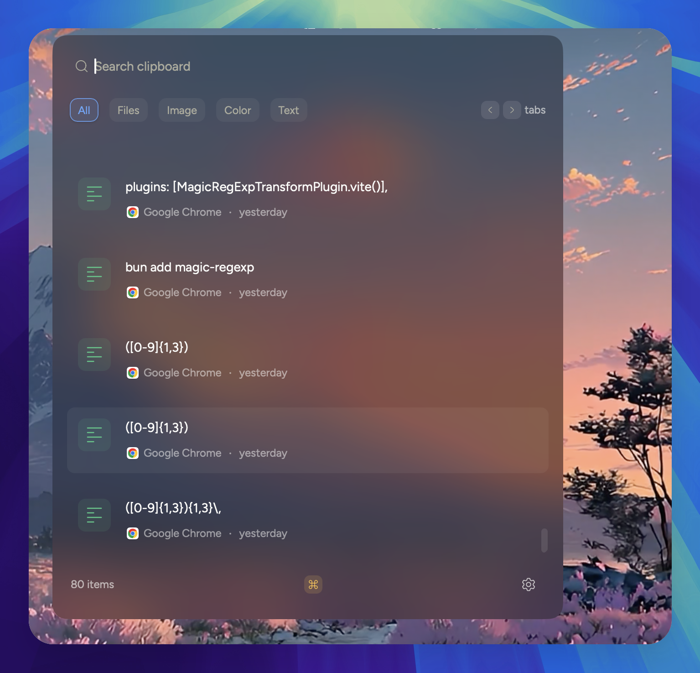
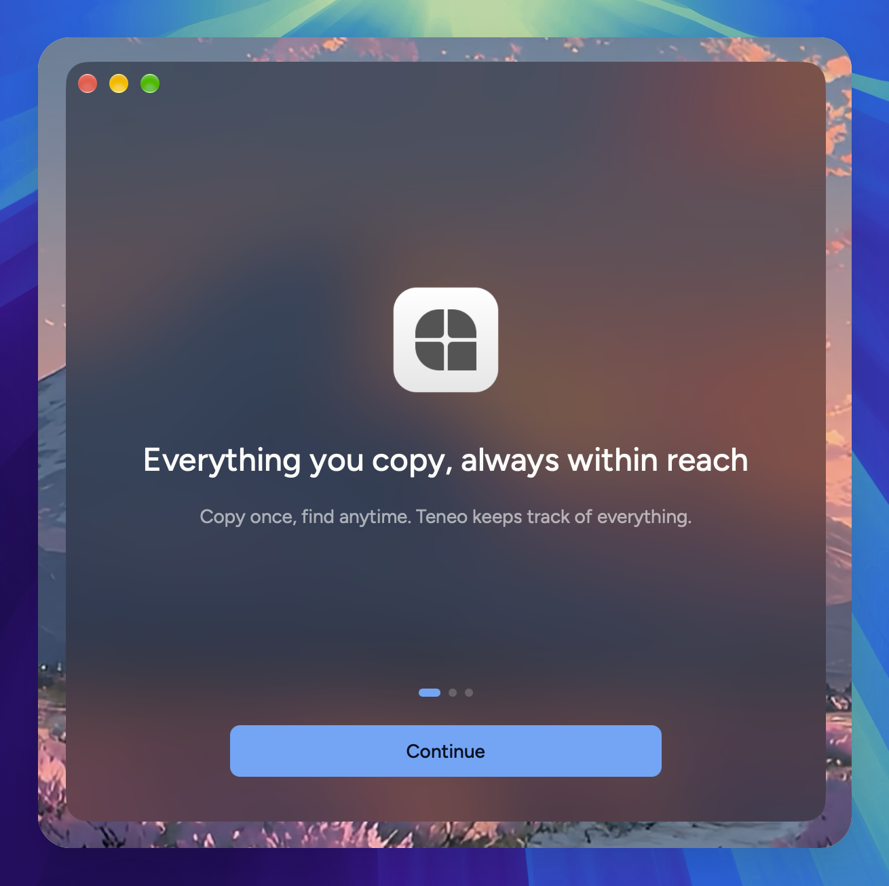
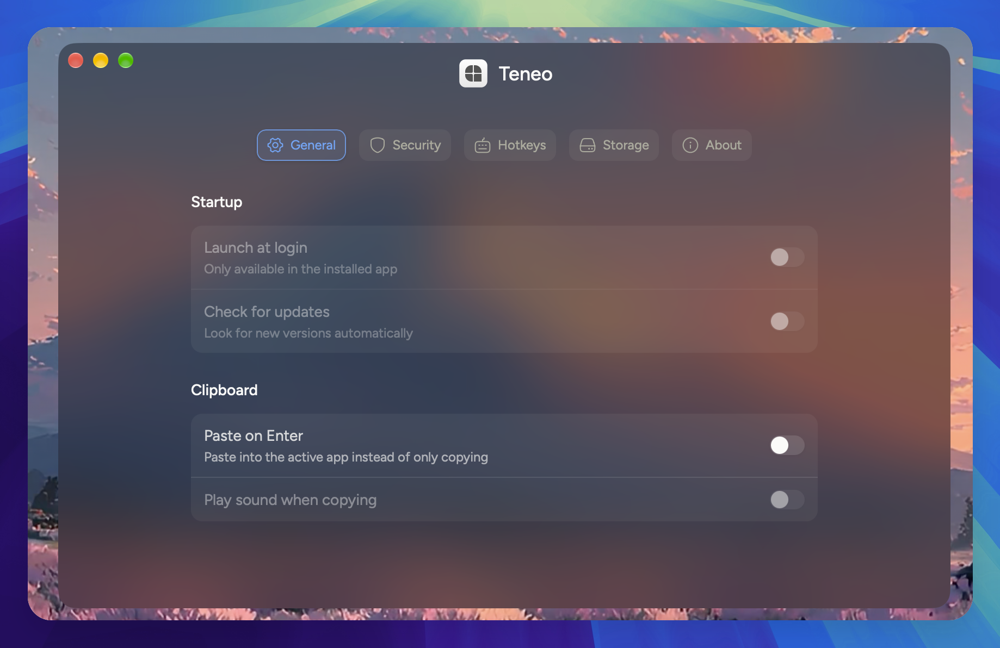
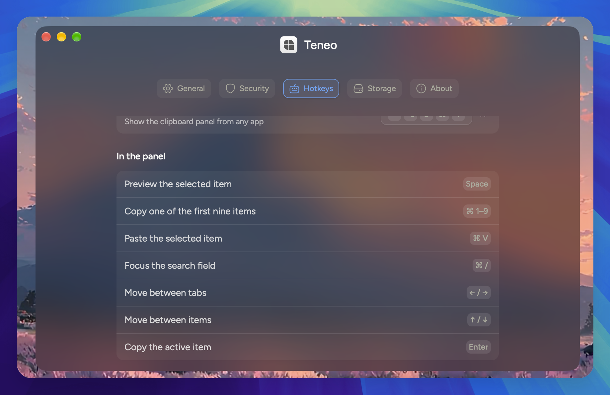

  

<h1 align="center">Teneo</h1>

Everything you copy, one click away in your menu bar.

  <a href="https://github.com/theCodeD3vil/teneo/releases/latest"><strong>Download for macOS</strong></a>

Teneo is a clipboard manager for your Mac. It sits quietly in the menu bar and remembers everything you copy. Your history is stored locally on your Mac. Nothing ever leaves.

## Installation

Teneo runs on macOS, on both Apple Silicon and Intel Macs.

1. Open the [latest release](https://github.com/theCodeD3vil/teneo/releases/latest) and download the disk image for your Mac:
   - **Apple Silicon** (M1 or later): `teneo-<version>-macos-arm64.dmg`
   - **Intel**: `teneo-<version>-macos-x86_64.dmg`

> Not sure which you have? Open the Apple menu › **About This Mac**. A **Chip** line means Apple Silicon; a **Processor** line means Intel.

2. Open the disk image and drag **Teneo** into **Applications**.
3. Open Teneo from Applications. macOS blocks it the first time, because Teneo isn't notarized by Apple yet. Click **Done**, then go to **System Settings › Privacy & Security**, scroll down to the bottom, and click **Open Anyway** next to the message about Teneo. You only need to do this once.
4. A welcome window walks you through setup. Complete it and Teneo is ready to be used.

### Accessibility permission

Teneo needs Accessibility permission to paste into the app you're using. Without it, Teneo still saves your history and copies items; you just paste them yourself with ⌘V.

You can allow it in either of two ways:

- **In Teneo's setup window.** Click **Grant access**: System Settings opens on the right page. Turn on **Teneo**, then come back, and the setup window moves on by itself. If you chose **Set up later**, open Teneo's Settings (the gear in Teneo's panel) and click **Finish setup** in the banner at the top to bring the setup window back.
- **Manually in System Settings.** Open **System Settings › Privacy & Security › Accessibility** and turn on **Teneo**. If Teneo isn't in the list, click **+** below it and choose Teneo from Applications.

Teneo's **Settings › Security** tab shows whether access is allowed.

Teneo keeps itself up to date: when a new version is out, it asks before installing it. You can also check any time from **Settings › About › Check now**.

## Features

- **Remembers everything you copy.** Text, images, files and colors are saved as you copy them, each with the app it came from and when.
- **Finds it fast.** Search your whole history, or narrow it down with the **Files**, **Image**, **Color** and **Text** tabs.
- **Works from the keyboard.** Set your own shortcut to open Teneo from any app, then:

  | Action                                   | Keys      |
  | ---------------------------------------- | --------- |
  | Move between items                       | `↑` / `↓` |
  | Move between tabs                        | `←` / `→` |
  | Copy the selected item                   | `Enter`   |
  | Copy one of the first nine               | `⌘ 1–9`   |
  | Paste the selected item into focused app | `⌘ V`     |
  | Pin or unpin the selected item           | `P`       |
  | Delete the selected item                 | `D`       |
  | Jump to the search field                 | `⌘ /`     |
  | Leave the search field                   | `Esc`     |

- **Pastes for you.** Paste straight into the app you were using, or turn on **Paste on Enter** to paste every time you pick an item. This also happens automatically with the `⌘ + 1-9` hotkeys and `⌘ + V` keys
- **Leaves passwords alone.** Anything copied from a password manager is skipped, and you can add any other app you want Teneo to ignore.
- **Keeps only what you want.** Choose how long to keep history (1 day to forever), how many items to keep, and how much space it may use. Pinned items always stay, and don't count toward these limits.

## Screenshots

  
   
  <em>Your clipboard history, searchable and sorted by type</em>

  
   
  <em>A short setup the first time you open Teneo</em>

  
   
  <em>General settings</em>

  
   
  <em>Every shortcut, in one place</em>

